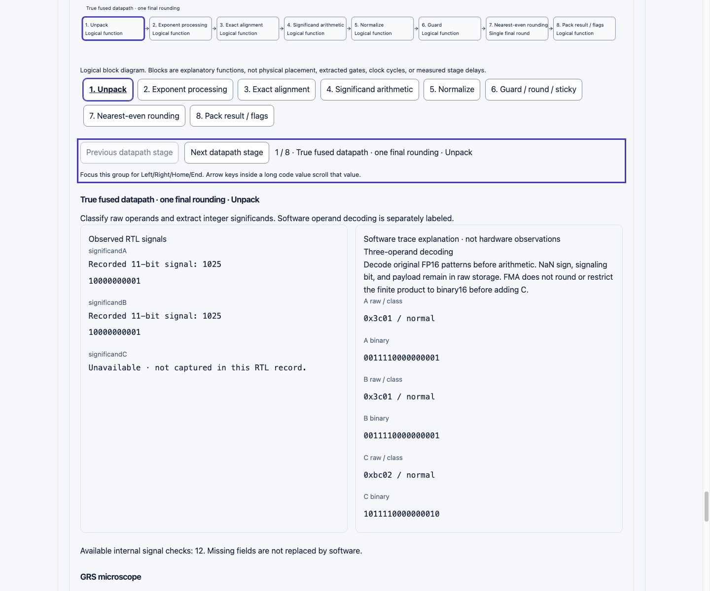

# Hardware Datapath Explorer

Open **Hardware Datapath Explorer** from the footer or visit `/fp-play/#datapath`.
Select addition, subtraction, multiplication, true FMA, or nonfused multiply-add,
then choose a verified hardware example. The dataset loads on request. No new
numerical operation, RTL architecture, plotting dependency, or browser HDL tool
is introduced.

## Five distinct kinds of evidence

| Layer                     | Meaning and source                                                                                                                                                                                              |
| ------------------------- | --------------------------------------------------------------------------------------------------------------------------------------------------------------------------------------------------------------- |
| Mathematics               | The existing exact BigInt dyadic numerical engine, including separately rounded nonfused operations. Coefficient/exponent is authoritative; an FMA Number projection can round.                                 |
| Logical stages            | Eight explanatory blocks: unpack, exponents, alignment, arithmetic, normalize, GRS, nearest-even round, pack. These are neither clock cycles nor physical placement or extracted gates.                         |
| Observed RTL              | Actual Verilator records with operand/result bits, flags, available internal signals, simulator version, corpus seed, and source hashes.                                                                        |
| Synthesized structure     | Milestone 12 functional-output wrappers, mapped cells and graph depth. Baseline and tree variants have whole-unit measurements, not block costs.                                                                |
| Area and timing estimates | Recorded Nangate45 typical (1.10 V, 25 C) mapping and ideal-interconnect OpenSTA estimates under the recorded constraints. No physical chip area, power, post-layout timing, or silicon validation is inferred. |

The diagram highlights one final rounding for true FMA. Nonfused has two rows:
pack the rounded multiplier result, then add C and round again. Its final flags
union both operations. FMA does not import intermediate product flags.

## Signals and examples

There are **97 selectable operation/example combinations from 51 recorded sets**:
28 add/sub records and 23 shared multiplication/FMA/nonfused triples. The
underlying full verification corpora contain 462,172 add/sub transactions and
301,544 triples. They are not all loaded into the frontend.

The exact engine checks every selected raw result and all four flags, including
NaN sign/payload policy. Tests replay every example and **768 available finite
internal-signal comparisons**: GRS, retained significand, rounding increment,
tininess, exact magnitude, and recorded product operands/product/scale/sign
where available. Other recorded fields are inspectable without claiming they
have a distinct independent stage comparison. Fixed-grid magnitudes use 2^-24
for add/sub and 2^-48 for multiplication/FMA. Their integers cannot be compared
to software alignment coordinates without converting scales.

Select a stage using native buttons, Previous/Next, or focus **Datapath stage
navigation** for Left/Right/Home/End. The selected block has a text/button state
as well as a visual outline. Long binary strings stay intact and individually
focusable/scrollable; their arrow keys do not change stages. Software trace
explanations are in a separate labeled column, with an expandable full trace
for the selected phase.

Missing fields say **Unavailable**. The add/sub artifact does not record
unpacked significands. The nonfused adder records its result and flags but not
its internal signals or finite-path status. No values from TypeScript fill
these gaps as hardware observations. Special bypass signals mark finite-stage
defaults as bypassed; they are not an executed finite rounding. An unknown bypass
status remains unknown.

Examples cover signed zero, NaNs, infinities, cancellation, carry, subnormal
boundaries, exact/even/odd ties, discarded tails, underflow, overflow, and lost
FMA residuals. For example, **Lost product residual** produces 0x0010 fused and
0x0000 nonfused. **Subnormal to normal product tie** reaches 0x0400.

Two historical product titles have reversed even/odd descriptions. Their
recorded GRS/retained/increment and bits are correct. The new selector labels
these as **Product midpoint · retained odd · increment** (0x3e02) and
**Product midpoint · retained even · stay** (0x3e04), using actual observations.
Original titles and immutable artifacts remain available in provenance.
Standalone multiplication uses only A and B; shared triple scenario names may
refer to the C operand used by FMA.

## GRS microscope

Six steps explain retained LSB, guard, round, sticky, increment, and carry or
transition. Use buttons or focus **GRS step navigation** for the same bounded
keyboard controls. The retained LSB is derived parity of a recorded integer;
G/R/S and increment are real recorded signals.

For nearest-even, increment = `G AND (R OR S OR retained LSB)`. GRS=100 is an
exact midpoint: retain an even significand, increment an odd one. The display
checks this Boolean expectation against the recorded increment. Carry from
retained=2047 and increment=1 is explicitly an inferred annotation, not a
recorded carry wire. Software carry and subnormal-to-normal transition are
separately labeled. A normal packed result can still raise underflow under the
engine's precision-only, unbounded-exponent tininess-after-rounding definition.

## Source-linked synthesis

The relevant unit table compares mapped cell count, cell area, estimated delay,
and logic depth for baseline/tree experiments. No tree-adder experiment exists.
Core baseline RTL hashes must match the simulation artifact or the comparison
is suppressed with an explanation. Optional malformed synthesis data does not
prevent inspection of valid simulation examples.

The metadata exposes exact library revision/hash, IO loading/slew constraints,
mapping settings, measurement commit/time, Yosys 0.70+219 (5053d0e26), ABC 1.01,
and OpenSTA 3.1.0 as recorded in Milestone 12. Fewer graph levels do not imply
lower delay: cell choice, drive, fanout, slew and loading matter. Read the
[controlled synthesis contract](HARDWARE_SYNTHESIS.md) for wrappers, verification,
full reproduction, library/tool pins, and limitations. No resynthesis or new
cost measurement is implied by the interactive view.

## Genuine waveform subset

Expand **Inspect recorded waveforms**. Select a signal; use native zoom/pan
buttons or the labeled frame range. The selected example's exact binary value
stays visible independently of the viewport. An expandable table provides all
visible values. Download links use the `/fp-play/` base and provide complete
original directed VCDs (not browser-generated waveforms).

The curated dataset contains 14 add/sub and 20 product-family top-level signals.
Values hold until their next recorded transition, including when an unchanged
transaction has no timestamp entry. Unknown X/Z values are preserved by the
parser. Observation `2i+1` is the settled transaction for directed example i;
reset/transaction observations alternate in these combinational testbenches.
VCD timescale headers are not propagation-delay measurements, pipeline latency,
or hardware clock evidence. This lightweight viewer is not a general VCD IDE.

## Reproducing records and validation

Use Node 22.9.0 or 24, the committed npm lockfile, Verilator, C++17, and the tool
requirements in [the RTL guide](../rtl/README.md) and
[multiplier/FMA guide](../rtl/MULTIPLY_FMA.md). From the repository root:

```sh
npm ci
make -C rtl test waveform
make -C rtl -f mul-fma.mk test waveform
node rtl/scripts/export-datapath-waveforms.mjs
npx prettier --write rtl/vectors/datapath-waveforms.json
npm run check
npm run check:release
```

The exporter requires complete zero-mismatch full and directed verification
certificates with current source hashes, expected corpus counts, directed sample
counts, and matching simulator versions. It parses the actual directed VCDs and
checks operands, results, flags, GRS, increment, and available product/magnitude
observations against the immutable recorded JSONs before writing
`public/artifacts/datapath-{add,product}.vcd` and
`rtl/vectors/datapath-waveforms.json`. Raw VCD, source JSON, parser and exporter
hashes are stored in the new artifact. Export again after editing either parser
or exporter. No existing RTL or historical artifact is changed by this command.
Different Verilator versions may change VCD declarations/format, so raw hashes
can differ while all checked observations agree.

Normal Vitest checks source hashes against actual repository files, reparses both
raw VCDs, verifies their exported subsets and all sample correlations, and rejects
invalid schemas, widths, bits, timing, paths, mismatched hashes, GRS/result/flag
corruption and malformed optional data. Bounded pure parsers/models live in
`src/lib/datapath/`; presentation lives in `src/components/datapath/`. Simulation,
synthesis, file IO and TypeScript transpilation run offline only. The browser
reports stored provenance; it does not rehash HDL files or execute HDL tools.

## Browser verification and remaining manual checklist

Actual **Chrome 156.0.8078.48**, headless with an isolated temporary profile, was
driven through its local DevTools protocol using Node's native WebSocket API.
Desktop 1440×1200 and mobile-emulated 390×844 / 320×800 layouts were checked.
Review covered direct hash opening, SVG rendering, light/dark themes, visible
keyboard focus, bounded stage keys, native range ArrowRight behavior, long-code
focus isolation, emulated touch stage selection, exact ties, signed zero,
subnormal transition, NaN/infinity, fused/nonfused results, waveform selection,
zoom/pan, raw VCD URLs, and accessibility-tree control labels. No runtime
exceptions were observed. The mobile check found and fixed an implicit-grid
minimum-width overflow; page scroll width now equals client width at 390/320 px,
while the diagram itself scrolls internally.



[Mobile dark-theme screenshot](images/datapath-mobile-dark.png).

This is not a screen-reader audit, physical touch-device test, cross-browser
certification, or full accessibility conformance claim. System-theme behavior,
200% zoom, sustained device interaction and complete assistive-technology review
remain manual. Run `npm run dev` or build/preview and use this reproducible
checklist before publication:

1. Visit `/fp-play/#datapath` directly and through the footer; close/reopen the
   section and repeat the hash link. Confirm all five operation selections.
2. At desktop width and 320/390/768 px widths, inspect the SVG blocks, two-row
   nonfused path, labels, tables, long 81-bit signals/exact decimals, source
   hashes, and horizontal scrolling. Check 200% zoom without lost controls.
3. Switch system/light/dark themes. Inspect contrast, selected-block outlines,
   visible keyboard focus, text legibility and native control states.
4. Tab through selectors, stage and GRS steps, disclosure summaries, downloads,
   and code values. Test Enter/Space and Left/Right/Home/End in navigation
   groups. Arrow keys on code must scroll, not change stages. Confirm bounds.
5. With a screen reader, verify labeled operation/example controls, diagram
   description, current-step buttons, headings, result/flag agreement, alerts,
   and live navigation updates. Confirm missing/bypassed signals are announced.
6. Compare Lost product residual fused/nonfused, both corrected midpoint labels,
   carry, cancellation, subnormal-to-normal, underflow, infinities and NaNs.
   Open full software/provenance and exact synthesis assumptions.
7. In waveforms select scalar and 81-bit bus signals, zoom in/out to bounds, pan
   via buttons/range/touch, inspect exact table and selected-example value, and
   download both raw VCDs under the production base. Verify no page overflow.
8. Check the existing bit/microscope/arithmetic/mixed/attention/hardware views
   still work after opening/closing this lazy workspace.
